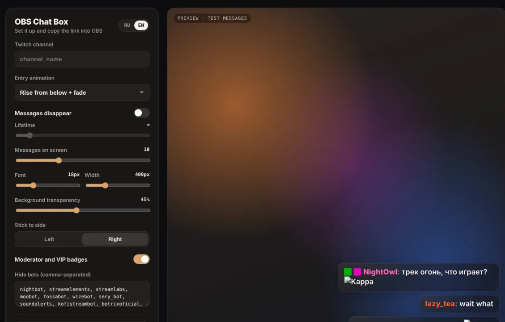
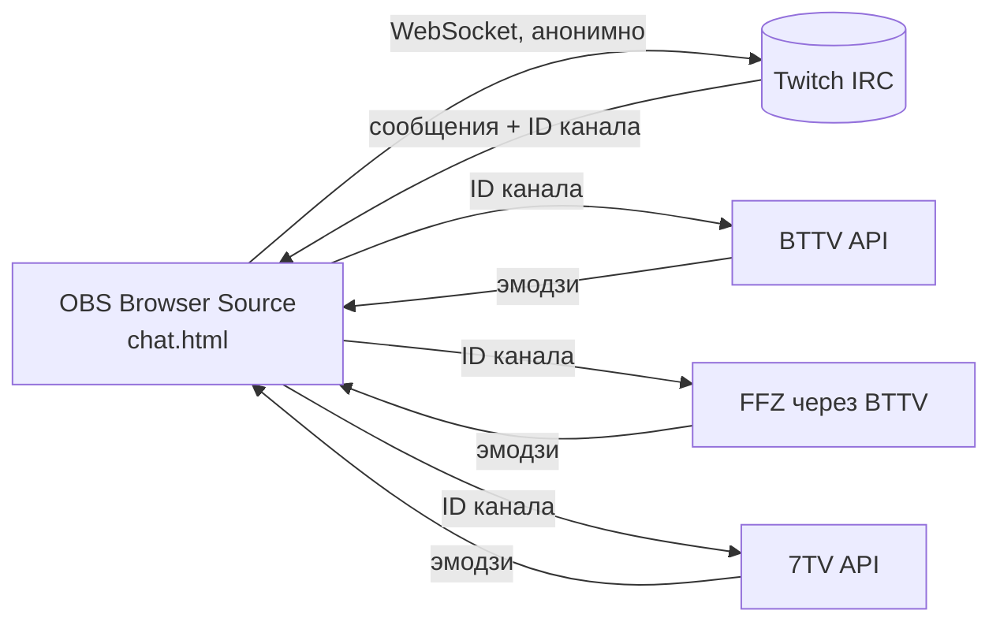

<div align="center">

# 💬 Chat Box для OBS

**Оверлей чата Twitch с плавными анимациями.**
**Без регистрации, настраивается за минуту.**


<!-- Сделай скриншот страницы настроек, положи его в репозиторий как preview.png — и он появится здесь -->


[**Открыть настройки →**](https://1yandurask.github.io/chatbox757/)

</div>

---

## ✨ Возможности

| | |
|---|---|
| 🪟 **Стекло** | Полупрозрачные карточки с тонировкой, бликом и тонкой рамкой |
| 😀 **Все эмодзи** | Twitch, BTTV, FrankerFaceZ и 7TV, включая zero-width, которые накладываются на соседний эмодзи |
| 🛡️ **Значки** | Модераторы и VIP |
| 🎬 **Анимации** | Всплытие + fade, fade, выезд сбоку, пружинка или без анимации; старые сообщения плавно уезжают вверх |
| ⏱️ **Время жизни** | Сообщения исчезают через N секунд или висят бесконечно |
| 🤖 **Без ботов** | Nightbot, StreamElements, Streamlabs и другие скрыты, список можно менять |
| 🧹 **Модерация** | Удалённые сообщения и сообщения забаненных пропадают с экрана сразу |
| 🌐 **RU / EN** | Страница настроек на двух языках |

## 🚀 Быстрый старт

1. Открой [страницу настроек](https://1yandurask.github.io/chatbox757/).
2. Введи имя канала и настрой вид — превью справа обновляется сразу.
3. Нажми **«Скопировать ссылку для OBS»**.
4. В OBS: **Источники → ➕ → Браузер**, вставь ссылку.
5. Размер источника: **ширина чата + 32 px** (например, `432`), высота — сколько места отвести чату (до `1080`).
6. Поставь источник у правого края сцены. Готово 🎉

> [!TIP]
> Настройки сохраняются в браузере: в следующий раз страница откроется с ними.

## 📦 Установка на свой GitHub Pages

```text
├── index.html   ← страница настроек с превью
├── chat.html    ← сам оверлей для OBS
└── README.md
```

1. Создай репозиторий и загрузи файлы в корень.
2. **Settings → Pages → Build and deployment**: `Deploy from a branch`, ветка `main`, папка `/ (root)`.
3. Через минуту сайт будет доступен по адресу `https://1yandurask.github.io/chatbox757/`.

## ⚙️ Параметры ссылки

Все настройки живут в адресе `chat.html`, поэтому ссылку можно поправить и вручную.

| Параметр | Что делает | Значения | По умолчанию |
|---|---|---|---|
| `channel` | Канал Twitch | имя канала | — |
| `anim` | Анимация появления | `rise` · `fade` · `slide` · `pop` · `none` | `rise` |
| `life` | Через сколько секунд сообщение исчезает | `0` = бесконечно | `0` |
| `max` | Сообщений на экране | `1`–`50` | `10` |
| `size` | Размер шрифта, px | `10`–`48` | `18` |
| `width` | Максимальная ширина сообщения, px | `200`–`1200` | `400` |
| `glass` | Плотность стекла | `0` (прозрачно) – `100` | `55` |
| `align` | К какому краю прижат чат | `left` · `right` | `right` |
| `badges` | Значки модераторов и VIP | `0` — скрыть | показаны |
| `bots` | Кого скрывать | логины через запятую | список популярных ботов |
| `demo` | Тестовые сообщения | `1` — включить | выкл. |

**Пример:**

```text
chat.html?channel=my_channel&anim=rise&life=30&max=8&size=20&width=420&glass=60
```

## 🔧 Как это работает



- К чату подключается анонимный гость (`justinfan`): никаких токенов, ключей и приложений в Twitch Developer.
- Эмодзи Twitch приходят прямо в сообщениях, а для BTTV, FFZ и 7TV оверлей узнаёт ID канала из самого чата.
- Эмодзи сторонних сервисов обновляются каждые 10 минут, перезапускать источник не нужно.
- При конфликте названий приоритет такой: эмодзи канала важнее глобальных, 7TV > BTTV > FFZ.

## ❓ Частые вопросы

<details>
<summary><b>Почему стекло не размывает игру под чатом?</b></summary>
<br>
Браузерный источник OBS видит только себя и не может размыть то, что лежит под ним в сцене. Эффект стекла собран из тонировки, блика и рамки — так же, как у других стеклянных виджетов для OBS.
</details>

<details>
<summary><b>Чат пустой</b></summary>
<br>

- Проверь, что в ссылке есть `channel=` и имя канала написано без ошибок.
- Сообщения появляются только новые — история чата не подгружается.
- Если пишешь в чат с аккаунта бота, проверь список `bots`.
</details>

<details>
<summary><b>Не видно эмодзи BTTV или 7TV</b></summary>
<br>
Эмодзи подгружаются после подключения к чату, это занимает пару секунд. Если сервис был недоступен, оверлей покажет название эмодзи текстом и подтянет картинки при следующем обновлении (каждые 10 минут) или после обновления источника в OBS.
</details>

<details>
<summary><b>Как сделать чат меньше или больше?</b></summary>
<br>
Меняй <code>size</code> и <code>width</code> в настройках, а не масштаб источника в OBS — так текст останется чётким.
</details>

---

<details>
<summary>🇬🇧 <b>English</b></summary>

### Chat Box for OBS

A glassy Twitch chat overlay with smooth animations. No sign-up, no backend.

**Features:** Twitch, BTTV, FFZ and 7TV emotes (zero-width included) · moderator and VIP badges · five entry animations · message lifetime or infinite · bot filter · deleted and banned messages disappear instantly · RU/EN settings page.

**Setup:**
1. Open the settings page, enter your channel, tweak the look.
2. Click **Copy link for OBS**.
3. In OBS add a **Browser** source, paste the link, set width to *chat width + 32 px*.
4. Place it on the right edge of your scene.

**Hosting:** upload `index.html` and `chat.html` to a repo and enable GitHub Pages (`main`, root).

All URL parameters are listed in the table above.
</details>

<div align="center">
<sub>Сделано для стримов, работает на чистом HTML и JS ✦</sub>
</div>
